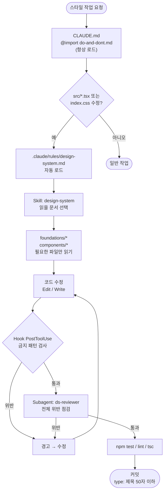
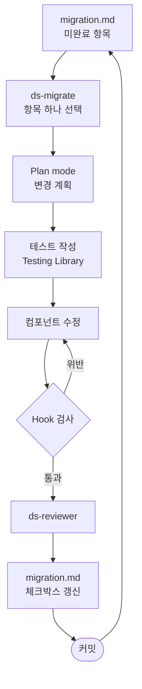
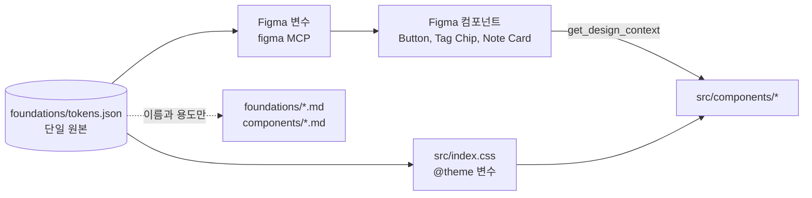
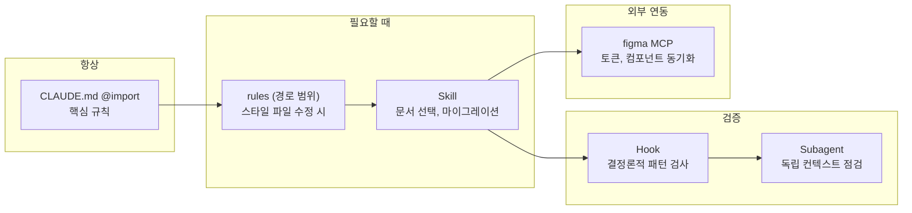

# 디자인 시스템 관리 구조 (제안)

디자인 시스템을 파일로 세분화하고, Claude Code 기능(rules, skill, subagent, hook, MCP)으로 관리하기 위한 **제안(목표 구조)** 문서다.
아직 구현되지 않았다. 현재 존재하는 파일은 [README.md](./README.md)의 목차를 본다.

이 문서에서 "토큰"은 AI 컨텍스트 단위가 아니라 **디자인 토큰**(값에 붙인 이름. 예: `tertiary` = `#0053dc`)을 뜻한다.

## 1. 파일 구조

### 현재 (6개 파일)

```
docs/design-system/
├── README.md
├── colors.md
├── typography.md
├── elevation-spacing.md
├── components.md
└── do-and-dont.md
```

### 목표 (제안)

```
docs/design-system/
├── README.md                  # 철학 + 목차 (진입점)
├── design-system-diagram.md   # 이 문서
├── migration.md               # 현행 코드 ↔ 디자인 시스템 차이, 파일 단위 체크리스트
├── foundations/               # 토큰 (1파일 1주제)
│   ├── colors.md
│   ├── typography.md
│   ├── spacing.md
│   ├── elevation.md
│   └── tokens.json            # 토큰 단일 원본 (hex, rem 값)
├── components/                # 컴포넌트당 1파일
│   ├── button.md
│   ├── card-list.md
│   ├── input.md
│   ├── tag-chip.md
│   └── dialog.md
└── rules/
    └── do-and-dont.md
```

### 파일별 역할 및 현재 → 목표 매핑

| 목표 파일                   | 역할                                                      | 현재 출처                            |
| --------------------------- | --------------------------------------------------------- | ------------------------------------ |
| `README.md`                 | 철학(Curated Archive), 문서 목차, 사용 방법               | `README.md` (마이그레이션 표는 분리) |
| `migration.md`              | 현행 코드와의 차이 표, 컴포넌트별 완료 체크리스트         | `README.md`의 "현행 코드와의 차이"   |
| `foundations/colors.md`     | No-Line 규칙, Surface 계층, Glass & Gradient, 액센트      | `colors.md`                          |
| `foundations/typography.md` | Inter(+Pretendard) 스케일과 위계                          | `typography.md`                      |
| `foundations/spacing.md`    | 1.4rem 간격 리듬, 간격 스케일                             | `elevation-spacing.md` 분리          |
| `foundations/elevation.md`  | 레이어링, Ambient Shadow, Ghost Border                    | `elevation-spacing.md` 분리          |
| `foundations/tokens.json`   | 토큰 이름과 값의 단일 원본                                | 신규 (hex가 흩어진 md에서 추출)      |
| `components/button.md`      | Primary / Secondary / Ghost 버튼                          | `components.md` Buttons              |
| `components/card-list.md`   | 카드, 리스트, hover, 선택 상태 (NoteItem, NoteList)       | `components.md` Cards & Lists        |
| `components/input.md`       | 입력창, 라벨 (NoteEditor 폼)                              | `components.md` Input Fields         |
| `components/tag-chip.md`    | Knowledge Token(태그 칩)                                  | `components.md` Knowledge Token      |
| `components/dialog.md`      | 모달, 다이얼로그 (Alert, Confirm). Glass + Ambient Shadow | `components.md` Floating 요소        |
| `rules/do-and-dont.md`      | Do / Don't 규칙, Tailwind 예시. hook 검사 규칙의 근거     | `do-and-dont.md`                     |

원칙

- 한 파일은 약 80줄 이하로 하고 하나의 질문에 답한다.
- hex 값은 `tokens.json`에만 둔다. 다른 문서는 토큰 이름과 용도만 쓴다.
- 파일 이동은 `git mv`로 이력을 보존하고, 상대 링크와 CLAUDE.md 경로를 함께 고친다.

## 2. Claude Code 설정 구조 (제안)

```
.claude/
├── rules/
│   └── design-system.md       # paths: src/**/*.tsx, src/index.css
├── skills/
│   ├── mermaid-diagram/       # 기존
│   ├── design-system/         # 신규: 읽을 문서 선택
│   └── ds-migrate/            # 신규: 마이그레이션 1회분 실행
├── agents/
│   └── ds-reviewer.md         # 신규: 규칙 위반 점검 (읽기 전용)
└── settings.json              # hooks (팀 공유)
```

`CLAUDE.md`의 디자인 시스템 절은 `@docs/design-system/rules/do-and-dont.md`만 import한다. 항상 컨텍스트에 있어야 하는 건 핵심 규칙뿐이다.

## 3. Skill 목록

| Skill             | 상태 | 트리거                                                         | 기능                                                                                                                                       |
| ----------------- | ---- | -------------------------------------------------------------- | ------------------------------------------------------------------------------------------------------------------------------------------ |
| `design-system`   | 신규 | 색, 버튼, 간격, 스타일, 디자인 시스템 등 스타일 작업 언급      | 작업 대상별 매핑표로 읽을 문서를 고른다. 예: 버튼이면 `components/button.md` + `foundations/colors.md`. 세부 내용은 필요할 때만 읽는다.    |
| `ds-migrate`      | 신규 | "마이그레이션", "디자인 시스템 적용", `migration.md` 항목 언급 | `migration.md`에서 미완료 항목 하나를 골라 해당 컴포넌트를 수정하고, 체크박스를 갱신하고, lint와 tsc를 돌린다. 한 번에 파일 하나만 다룬다. |
| `mermaid-diagram` | 기존 | 구조 시각화, 아키텍처 다이어그램 요청                          | `src/`를 분석해 `docs/architecture/index.html`을 생성한다. 디자인 시스템과 직접 관련은 없다.                                               |

## 4. Subagent

| Subagent      | 도구      | 역할                                                                                                                                                            |
| ------------- | --------- | --------------------------------------------------------------------------------------------------------------------------------------------------------------- |
| `ds-reviewer` | 읽기 전용 | 변경된 `src/**/*.tsx`, `src/index.css`를 `rules/do-and-dont.md`와 대조해 위반 목록(파일:줄)만 반환한다. 독립된 컨텍스트에서 돌아 메인 대화를 오염시키지 않는다. |

Skill과 Subagent의 차이: skill은 메인 대화 안에서 지침을 불러오고, subagent는 별도 컨텍스트에서 작업한 뒤 결과만 돌려준다.

## 5. Hook 종류와 역할

| Hook 이벤트   | 대상 도구   | 역할                                                                                                                                     | 강도                        |
| ------------- | ----------- | ---------------------------------------------------------------------------------------------------------------------------------------- | --------------------------- |
| `PostToolUse` | Edit, Write | `src/**/*.tsx`, `src/index.css`에서 금지 패턴을 검사한다. `border-b` / `border-r` / `border-t`, `h-px`, `text-black`, `#000`, `gray-` 등 | 처음엔 경고, 이후 차단 검토 |
| `PreToolUse`  | Edit, Write | (후보) 위 패턴을 쓰기 전에 막는다. 오탐이 많으면 불편하므로 `PostToolUse` 경고가 안정된 뒤에 도입한다.                                   | 차단                        |
| `Stop`        | -           | (후보) 응답 종료 시점에 변경된 UI 파일이 있으면 `ds-reviewer` 실행을 안내한다.                                                           | 안내                        |

Hook은 문서 규칙을 **결정론적 검사**로 바꾸는 장치다. 문서는 Claude가 읽고 판단하지만, hook은 항상 같은 결과를 낸다. 설정은 팀 공유용 `.claude/settings.json`에 둔다.

## 6. 전체 흐름도

### 6-1. 스타일 작업 흐름



### 6-2. 마이그레이션 흐름 (ds-migrate)



### 6-3. 토큰 동기화 흐름



### 6-4. 기능별 역할 한눈에 보기



## 7. 적용 순서

각 단계는 독립 커밋으로 한다. 커밋 형식은 `type: 제목` (제목 50자 이하).

| 단계 | 내용                                                                             | 커밋 type          |
| ---- | -------------------------------------------------------------------------------- | ------------------ |
| 1    | 문서 분리: `git mv`로 구조 생성, 링크와 CLAUDE.md 경로 갱신, `migration.md` 분리 | `docs`             |
| 2    | `tokens.json` 도입, md에서 hex 제거                                              | `docs`             |
| 3    | CLAUDE.md `@import` 전환, `.claude/rules/` 추가                                  | `chore`            |
| 4    | Skill(`design-system`, `ds-migrate`)과 Subagent(`ds-reviewer`) 추가              | `chore`            |
| 5    | Hook 추가 (`.claude/settings.json`)                                              | `chore`            |
| 6    | Figma 동기화: 토큰 변수와 핵심 컴포넌트 생성                                     | `feat` 또는 `docs` |
| 7    | 코드 마이그레이션: Layout → NoteItem → NoteEditor → Alert/Confirm                | `style`/`refactor` |

## 8. 열린 결정 사항

- 토큰 동기화: 수동(skill이 안내)으로 둘지, 스크립트로 `tokens.json` → `@theme` CSS를 자동 생성할지.
- Hook 강도: 경고만 할지, 위반 시 차단할지. (처음엔 경고를 권장)
